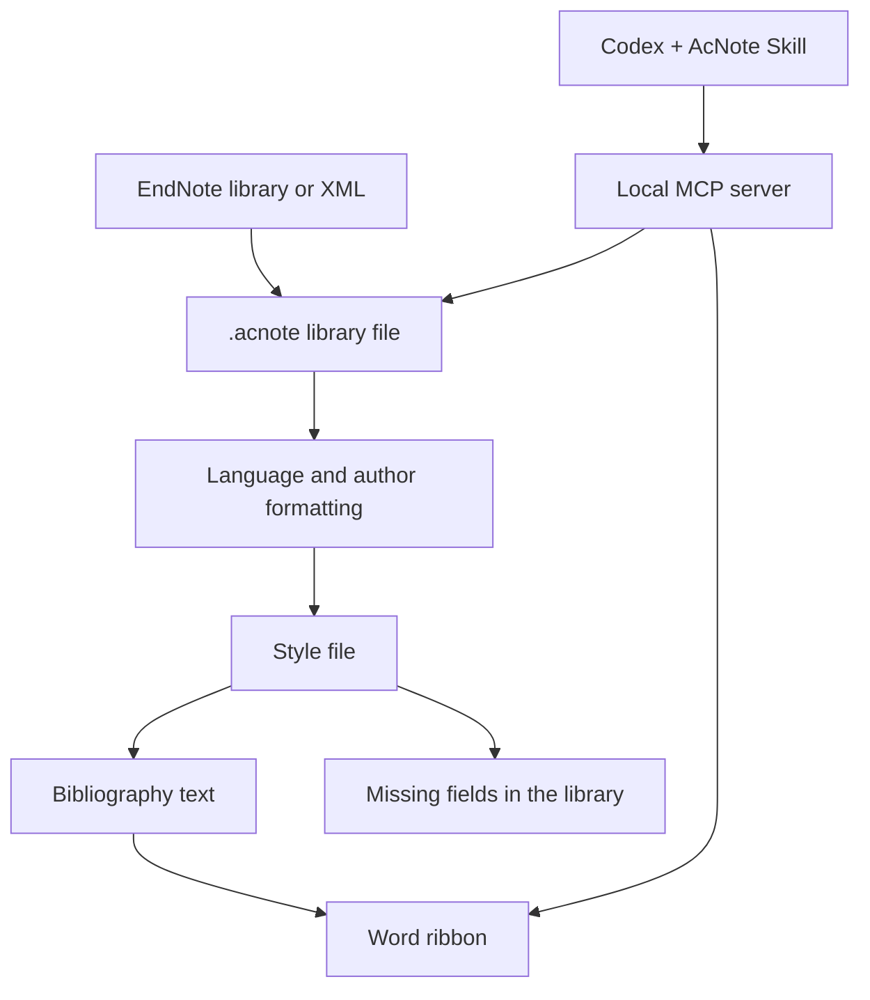

<div align="center">

# AcNote


### Citations, styled for the manuscript.

A reference manager organized around citation styles: Chinese and English author lists, shared style files, and citations that can be updated in Word.

[GitHub project](https://github.com/DLWangSan/acnote) · [Downloads and updates](https://github.com/DLWangSan/acnote/releases) · [简体中文](README.zh-CN.md) · [What it does](#what-it-does) · [Libraries and styles](#libraries-and-styles) · [Running it](#running-it)


</div>

## Why this project

Collecting papers is a solved problem in several existing tools. Formatting the bibliography for a thesis or a journal is still awkward, especially when one document mixes Chinese and English:

- Chinese author lists often need **等**, and English lists need **et al.** Doing that with an extra field on every record is tedious.
- A school style is usually a small change to a national standard. Editing a long stylesheet for a comma or an author cutoff is more work than the change itself.
- Missing volume, issue, or pages shows up as a broken reference, and it is easy to miss until submission.
- After the citations are in Word, changing the style or adding a paper should update the document, not leave a block of static text.

AcNote keeps the bibliographic record as a description of the source. The style file decides how that record is printed.

## What it does

### Chinese and English author lists

The language comes from the record when it is set, otherwise from the title (Han characters or Latin letters). You can override it per record. Author names stay in one field.

| Record language | Example |
| --- | --- |
| Chinese | 张三, 李四, 王五, 等. … |
| English | Smith J, Johnson A, Brown R, et al. … |

GB/T 7714 lists every author when there are three or fewer, and the first three plus 等 / et al. when there are more. A style file can change the cutoff and the suffix, including whether a comma appears before 等.

Chinese names stay as entered. Western names stored as `Smith, John` are printed as `Smith J`.

Author-Year in-text citations use the family name: `(袁隆平, 1966)`, `(Watson and Crick, 1953)`. The style file sets a separate cutoff for the citation and the bibliography. The built-in citation rule keeps the first author and adds 等 / et al. when there are three or more.

### Reference types

Journal articles, books, theses, book chapters, conference papers, and datasets. A dataset keeps its URL. Sample records in a new library are published works: 袁隆平 1966, the 1979 artemisinin structure paper, Watson and Crick 1953, 王国维《人间词话》, Turing's 1938 dissertation, Vaswani et al. 2017, and the MNIST dataset.

### Word

Run AcNote once, save your documents, then **close every Word window and reopen Word** to load the updated ribbon. Add-in builds are installed into separate version directories so upgrading does not overwrite DLLs held open by Word.

- **插入已选文献 / Insert selected references** inserts the desktop library selection directly, without reopening a picker. Checkboxes and Ctrl / Shift support multiple references.
- **查找并插入 / Find and insert** opens the searchable picker.
- **存为 AcNote 版副本 / Save as AcNote copy** converts EndNote citations in a new document beside the original and leaves the source file untouched. Formatted EndNote documents usually carry a Traveling Library with the references cited in that document; if records or citation numbers are missing, the add-in asks for the matching `.enl`, `.enlx`, or EndNote XML file. Uncited references from the original EndNote library are not stored in the Word document and require importing that library separately.
- **编辑引用 / Edit citation** restores the existing selection. **移除此处引用 / Remove citation** removes that occurrence and renumbers the document.
- **Ctrl+click a citation marker** jumps to its matching bibliography entry. In grouped citations, each visible marker links to its own entry.
- **更新引用和列表 / Update citations and bibliography** refreshes the document. Use the adjacent style dropdown to switch styles.
- **字体、段落与版式 / Fonts, paragraphs and style** configures citation and bibliography fonts, sizes and superscript, plus bibliography line spacing, paragraph spacing, hanging indent and alignment.

The bibliography starts in a separate paragraph with a blank line before it. Inserting a citation moves the caret outside its content control. Removing the last citation clears its bibliography on refresh.

Documents remember the library path and style. Refresh uses that bound library even if another library is open in the desktop app. Missing records stop the update before existing citation text is overwritten; moved libraries currently need to be restored to their bound path. Author-year collisions get consistent `2020a / 2020b` labels throughout the document without changing stored years.

Desktop shortcuts: `Ctrl+2` inserts selected references, `Ctrl+N` creates a record, and `Ctrl+S` saves. The bottom preview covers selected records; Word resolves year collisions across all references cited in the document.

The installer includes both x64 and x86 Word/WPS COM add-ins and registers the matching registry views, so 32-bit WPS can load the add-in on 64-bit Windows. It installs whichever .NET 10 Desktop Runtime architectures are missing and waits for Word/WPS to close before registration. The app also has a **Check/repair Word and WPS add-in** action. Office loads add-ins at startup, so fully exit all Word and WPS processes after installing or repairing. If a tab is still missing, check `%AppData%\AcNote\word-registration.log` for the registered COM paths.

### Codex and MCP

The installer includes a local `AcNote.Mcp.exe` server and an `acnote` Skill. The Skill defines how an AI should find, verify, and insert references; the MCP server exposes controlled local operations. Codex works through the running AcNote application with its current library and Word document. It does not read or write the `.acnote` database directly, and it does not require a separate AI-only library.

Nine MCP tools are currently available:

| Tool | Purpose |
| --- | --- |
| `get_status` | Check AcNote, the current library, and the active Word document |
| `create_library` | Create and open a library at an absolute `.acnote` path without overwriting existing files |
| `open_library` | Open an existing `.acnote` library |
| `import_references` | Import up to 20 EndNote, BibTeX, RIS, CSL JSON, or Zotero files into the current library |
| `search_references` | Search by title, author, year, journal, DOI, URL, or source key |
| `get_references` | Read exact records by stable ID and check fields required by the current style |
| `get_word_context` | Inspect the active Word selection, nearby text, and AcNote binding |
| `insert_citation` | Insert a managed citation at the cursor or before/after a unique exact-text anchor |
| `update_citations` | Refresh every citation and the bibliography using the document's bound library and style |

After installing AcNote, run this in PowerShell:

```powershell
& "$env:LOCALAPPDATA\Programs\AcNote\codex\Install-Codex.ps1"
```

The script installs the Skill into the Codex skills directory and registers the local MCP server. It first honors `CODEX_CLI_PATH`, then looks for the CLI bundled with Codex Desktop, so a separate global CLI installation is normally unnecessary. Restart Codex after the script succeeds, then start AcNote and open the library and Word document needed for the task.

For example, ask Codex:

> Create `D:\Paper\Review.acnote` and import the three `.enl` paths I provide. Report each import result, then find and verify references for the active Word document. Show the proposed sources and locations before inserting them, and finally update all citations and the bibliography.

MCP paths must be absolute, and an imported `.enl` must remain beside its matching `.Data` directory. Batch imports return added, updated, warning, and error details for each file. The Skill tells Codex to use stable IDs returned by AcNote, never invent a reference, never substitute manually typed numbers for managed citations, and never overwrite manuscript prose merely to place a citation. An ambiguous text anchor is rejected until the location is made explicit.

Before upgrading AcNote, fully exit Codex Desktop, AcNote, Word, and WPS. A running `AcNote.Mcp.exe` may hold `AcNote.Core.dll`. If the installer reports `DeleteFile failed; code 5`, close those applications and choose **Try again**; do not choose **Skip this file**.

### Import

EndNote X9.3 and later `.enl` libraries, compressed `.enlx` libraries, and EndNote XML can be imported. The original library is only read. Older EndNote libraries need an EndNote XML export.

The Word ribbon's **存为 AcNote 版副本** command creates a sibling file named `原文件名-AcNote.docx` (or preserves the source document's extension) and a matching `.acnote` library. Existing files are not overwritten; a numbered suffix is added when needed.

## Libraries and styles

A library is an `.acnote` file. **新建文献库** creates one, **打开文献库** switches to another, and the last file is opened again next time. One person can keep a thesis library and a paper library side by side. References are added inside the open file.

Missing fields are listed in that library, from the active style and the reference type. The Word document omits empty fields and does not print placeholders.

A style is a JSON file with a `.style` extension. One style can `extend` another and override only the rules that differ. **编辑版式** opens the current file; saving writes it to `%AppData%\AcNote\styles`, and that copy replaces the built-in style with the same `id`. **导入版式** installs a file the same way.

The style list shows two classics, then university names:

- `GB/T 7714` — numeric
- `Author-Year` — author-year, extending GB/T 7714
- `中山大学`, `北京大学`, `清华大学` — unverified templates extending GB/T 7714; not validated university specifications

```json
{
  "id": "sysu",
  "name": "中山大学",
  "extends": "gb-t-7714-2015-numeric",
  "group": "university"
}
```

## How it is put together

The formatter does not live inside the Word add-in. The desktop program owns the open library and the style files. Word asks it to pick records and then writes the formatted text back into the document.



## Who it is for

People formatting a thesis or a paper against a specific style, especially when the bibliography mixes Chinese and English. It is not a PDF reader, and it is not trying to cover search, recommendations, or annotation.

## Quick Start

1. Download the latest **Windows x64 installer** from [GitHub Releases](https://github.com/DLWangSan/acnote/releases).
2. Run the installer. It checks for the .NET 10 Desktop Runtime and guides you through installing it if needed. Close Word and WPS when the installer asks.
3. Launch AcNote once, then fully close and reopen Word or WPS so its AcNote ribbon can load.
4. Create or open an `.acnote` library in AcNote, select references, then insert and update them from the Word/WPS ribbon.
5. To use AcNote from Codex, run the `Install-Codex.ps1` command above, restart Codex, and let it operate the current library and Word document through the AcNote Skill and MCP server.

AcNote currently requires 64-bit Windows. If the ribbon does not appear, use **Check/repair Word and WPS add-in** in AcNote, then restart the word processor.

## Contributing

Pick any item that sounds useful:

- [ ] Found a bug or have an idea? [Open an issue](https://github.com/DLWangSan/acnote/issues/new). Include the AcNote version, Word/WPS version, steps to reproduce, and what you expected to happen.
- [ ] Have a university or journal style to share? Improve a `.style` file in `styles/`, test it with sample references, then [start a pull request](https://github.com/DLWangSan/acnote/compare). Include the style requirements or source and example output. First time contributing? See GitHub's guide to [creating a pull request from a fork](https://docs.github.com/en/pull-requests/how-tos/create-pull-requests/creating-a-pull-request-from-a-fork).
- [ ] Tried AcNote with Word or WPS? Share your version and feedback in an [issue](https://github.com/DLWangSan/acnote/issues/new).

## Design choices

1. The stored record describes the source. The style file describes the printed form.
2. A library is a file, so different projects stay separate.
3. Missing fields are shown in the library, not inserted into the manuscript.
4. A school style should be a small file that extends a base style.
5. Word keeps the record id, so a later refresh can change the printed text.

<div align="center">

[简体中文](README.zh-CN.md)

</div>

<details>
<summary>Build and verify from source</summary>

Install the [.NET 10 SDK](https://dotnet.microsoft.com/download/dotnet/10.0), then run:

```powershell
dotnet run --project src/AcNote.App
dotnet build AcNote.sln -c Release
dotnet test AcNote.sln -c Release
```

On Windows with desktop Word installed, optionally run `dotnet run --project tests/AcNote.Word.Smoke`. It uses temporary documents to check citation and bibliography behavior. Ribbon interactions and WPS compatibility require separate checks; see [TESTING.md](TESTING.md).
</details>

## Star History

<a href="https://www.star-history.com/?repos=DLWangSan%2Facnote&amp;type=date&amp;legend=top-left">
  <picture>
    <source media="(prefers-color-scheme: dark)" srcset="https://api.star-history.com/chart?repos=DLWangSan/acnote&amp;type=date&amp;theme=dark&amp;legend=top-left" />
    <source media="(prefers-color-scheme: light)" srcset="https://api.star-history.com/chart?repos=DLWangSan/acnote&amp;type=date&amp;legend=top-left" />
    
  </picture>
</a>
