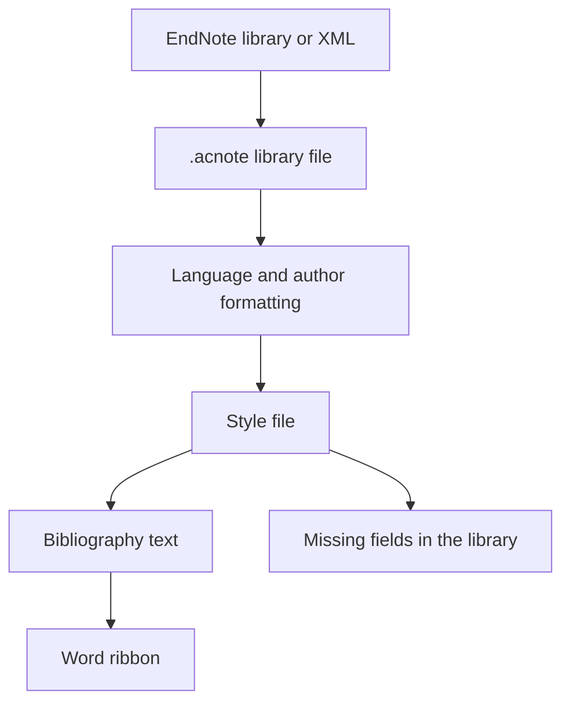

<div align="center">

# AcNote

### Citations, styled for the manuscript.

A reference manager organized around citation styles: Chinese and English author lists, shared style files, and citations that can be updated in Word.

[简体中文](README.zh-CN.md) · [What it does](#what-it-does) · [Libraries and styles](#libraries-and-styles) · [Running it](#running-it)


</div>

## Why this project

Collecting papers is a solved problem in several existing tools. Formatting the bibliography for a thesis or a journal is still awkward, especially when one document mixes Chinese and English:

- Chinese author lists often need **等**, and English lists need **et al.** Doing that with an extra field on every record is tedious.
- A school style is usually a small change to a national standard. Editing a long stylesheet for a comma or an author cutoff is more work than the change itself.
- Missing volume, issue, or pages shows up as a broken reference, and it is easy to miss until submission.
- After the citations are in Word, changing the style or adding a paper should update the document, not leave a block of static text.

AcNote keeps the bibliographic record as a description of the source. The style file decides how that record is printed.

## What it does

### Chinese and English author lists

The language comes from the record when it is set, otherwise from the title (Han characters or Latin letters). You can override it per record. Author names stay in one field.

| Record language | Example |
| --- | --- |
| Chinese | 张三, 李四, 王五, 等. … |
| English | Smith J, Johnson A, Brown R, et al. … |

GB/T 7714 lists every author when there are three or fewer, and the first three plus 等 / et al. when there are more. A style file can change the cutoff and the suffix, including whether a comma appears before 等.

Chinese names stay as entered. Western names stored as `Smith, John` are printed as `Smith J`.

Author-Year in-text citations use the family name: `(袁隆平, 1966)`, `(Watson and Crick, 1953)`. The style file sets a separate cutoff for the citation and the bibliography. The built-in citation rule keeps the first author and adds 等 / et al. when there are three or more.

### Reference types

Journal articles, books, theses, book chapters, conference papers, and datasets. A dataset keeps its URL. Sample records in a new library are published works: 袁隆平 1966, the 1979 artemisinin structure paper, Watson and Crick 1953, 王国维《人间词话》, Turing's 1938 dissertation, Vaswani et al. 2017, and the MNIST dataset.

### Word

Running AcNote registers its Word add-in in the current user account. Close Word and open it again. The ribbon tab is **AcNote**, with 插入引用, 编辑引用, 更新引用, and 版式.

The desktop program and the add-in share the library file that is currently open. Insert stores the record id in the document and refreshes the visible citation and bibliography from the current style.

WPS uses the same add-in registration. It has not been tried in WPS yet.

### Import

EndNote X9.3 and later `.enl` libraries, compressed `.enlx` libraries, and EndNote XML can be imported. The original library is only read. Older EndNote libraries need an EndNote XML export.

## Libraries and styles

A library is an `.acnote` file. **新建文献库** creates one, **打开文献库** switches to another, and the last file is opened again next time. One person can keep a thesis library and a paper library side by side. References are added inside the open file.

Missing fields are listed in that library, from the active style and the reference type. The Word document omits empty fields and does not print placeholders.

A style is a JSON file with a `.style` extension. One style can `extend` another and override only the rules that differ. **编辑版式** opens the current file; saving writes it to `%AppData%\AcNote\styles`, and that copy replaces the built-in style with the same `id`. **导入版式** installs a file the same way.

The style list shows two classics, then university names:

- `GB/T 7714` — numeric
- `Author-Year` — author-year, extending GB/T 7714
- `中山大学`, `北京大学`, `清华大学` — each extends GB/T 7714

```json
{
  "id": "sysu",
  "name": "中山大学",
  "extends": "gb-t-7714-2015-numeric",
  "group": "university"
}
```

## How it is put together

The formatter does not live inside the Word add-in. The desktop program owns the open library and the style files. Word asks it to pick records and then writes the formatted text back into the document.



## Who it is for

People formatting a thesis or a paper against a specific style, especially when the bibliography mixes Chinese and English. It is not a PDF reader, and it is not trying to cover search, recommendations, or annotation.

## Running it

Install the [.NET 9 desktop runtime](https://dotnet.microsoft.com/download/dotnet/9.0), then:

```powershell
dotnet run --project src/AcNote.App
```

The first launch copies built-in styles into `%AppData%\AcNote\styles` and registers the Word ribbon. Restart Word after that. Create or open an `.acnote` library from the toolbar. A new library can start with the classic sample records.

## Contributing

Style files are the most useful contribution. A school style should extend GB/T 7714 and use the university name. Bug reports are most useful with the style file, the record, and the expected string.

## Design choices

1. The stored record describes the source. The style file describes the printed form.
2. A library is a file, so different projects stay separate.
3. Missing fields are shown in the library, not inserted into the manuscript.
4. A school style should be a small file that extends a base style.
5. Word keeps the record id, so a later refresh can change the printed text.

<div align="center">

[简体中文](README.zh-CN.md)

</div>
