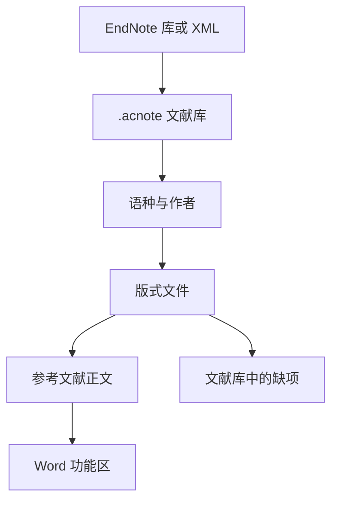

<div align="center">

# AcNote

### 按稿件要求排参考文献。

用来管理文献、套用可共享的版式，并在 Word 里更新引用。中文作者列表用「等」，英文用 et al.，不另建一套作者字段。

[English](README.md) · [能做什么](#能做什么) · [文献库和版式](#文献库和版式) · [运行](#运行)


</div>

## 为什么做

收集和阅读论文，现有工具已经够用。难的是按学校或期刊把参考文献排出来，尤其是一篇稿子里中英文都有：

- 中文要「等」，英文要 et al.。为了这一处显示去给每条文献加冗余字段，很烦。
- 学校版式往往只改国标的几处。为了一个逗号或作者人数去改一大段样式，不值当。
- 缺卷号、期号、页码时，生成结果只是空一截，交稿前不容易发现。
- 引用进 Word 之后，换版式或增删文献，应该能更新，而不是留下一段不能再改的文字。

文献记录负责把出处记清楚。印成什么样，由版式文件决定。

## 能做什么

### 中英文作者列表

语种优先用条目上的设置；没设时看题名里是汉字多还是拉丁字母多。每条文献可以改成中文或 English。作者只存一份。

| 文献语种 | 示例 |
| --- | --- |
| 中文 | 张三, 李四, 王五, 等. … |
| 英文 | Smith J, Johnson A, Brown R, et al. … |

GB/T 7714：三人及以下全部列出，超过三人列前三位，再加「等」或 et al.。版式文件可以改人数，也可以改「等」前面要不要逗号。

中文名按录入原样输出。英文名若是 `Smith, John`，印成 `Smith J`。

Author-Year 的文中引用用姓：`(袁隆平, 1966)`、`(Watson and Crick, 1953)`。文中和文末的人数分开写在版式里。内置文中规则是三人及以上只留第一作者，再加「等」或 et al.。

### 文献类型

期刊论文、图书、学位论文、图书章节、会议论文、数据集。数据集保留网址。新建文献库时可以放入这些已发表的例子：袁隆平 1966、青蒿素结构论文 1979、Watson 与 Crick 1953、王国维《人间词话》、图灵 1938 年学位论文、Vaswani 等 2017、MNIST 数据集。

### Word

运行 AcNote 后，会在当前 Windows 用户下登记 Word 插件。把已经打开的 Word 全部关掉再打开。功能区选项卡是 **AcNote**，命令是：插入引用、编辑引用、更新引用、版式。

主程序和插件共用当前打开的那份文献库。插入时在文档里记下文献编号，显示出来的引文和文末列表按当前版式生成。

WPS 走同一条插件登记，还没有在 WPS 里用过。

### 导入

可以导入 EndNote X9.3 及以后的 `.enl`、压缩的 `.enlx`，以及 EndNote XML。只读，不改原来的库。更早的 EndNote 库请先导出 XML。

## 文献库和版式

文献库是一个 `.acnote` 文件。**新建文献库** 建一份，**打开文献库** 换成另一份，下次启动会打开上次那份。同一个人可以分开做学位论文和期刊稿。文献加在当前打开的文件里。

缺哪些字段，由当前版式和文献类型决定，只列在文献库里。Word 里空字段会连同旁边多出来的标点一起省掉。

版式是扩展名为 `.style` 的 JSON。一个版式可以 `extends` 另一个，只写下不同的规则。**编辑版式** 打开当前这份；保存后写到 `%AppData%\AcNote\styles`，同 `id` 的文件会盖过软件自带的那份。**导入版式** 也是这样安装。

版式列表先是两套经典，后面是大学名：

- `GB/T 7714`：顺序编码
- `Author-Year`：著者-出版年，继承 GB/T 7714
- `中山大学`、`北京大学`、`清华大学`：各自继承 GB/T 7714

```json
{
  "id": "sysu",
  "name": "中山大学",
  "extends": "gb-t-7714-2015-numeric",
  "group": "university"
}
```

## 程序怎么分

排版不写在 Word 插件里。打开的文献库和版式在主程序中。Word 负责选文献，再把排好的文字写回文档。



## 给谁用

在按某一套版式写学位论文或期刊稿，而且参考文献里中英文都有的时候用。不做 PDF 阅读，也不做检索、推荐和批注。

## 运行

安装 [.NET 9 桌面运行时](https://dotnet.microsoft.com/download/dotnet/9.0)，然后：

```powershell
dotnet run --project src/AcNote.App
```

第一次运行会把自带版式复制到 `%AppData%\AcNote\styles`，并登记 Word 功能区。之后请重新打开 Word。在工具栏里新建或打开 `.acnote` 文献库。新建时可以选择放入经典示例。

## 参与

最有用的是版式文件。学校版式继承 GB/T 7714，名字用大学名。报告问题时，请带上版式文件、文献记录和期望的著录字符串。

## 几个约定

1. 库存的是出处，版式文件决定印出来的样子。
2. 文献库是文件，不同的稿子可以分开。
3. 缺项只显示在文献库，不写进稿子。
4. 学校版式尽量只写和基础版式不同的几行。
5. Word 里保存的是文献编号，以后刷新可以改显示文字。

<div align="center">

[English](README.md)

</div>
