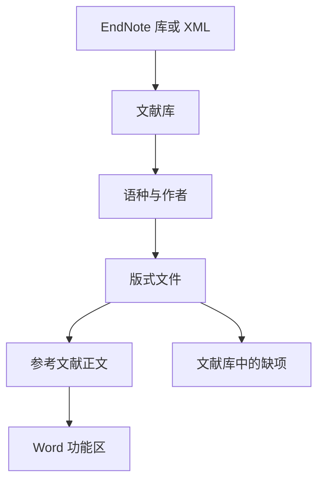

<div align="center">

# AcNote

### 按稿件要求排参考文献。

用来管理文献、套用可共享的版式，并在 Word 里更新引用。中文作者列表用「等」，英文用 et al.，不另建一套作者字段。

[English](README.md) · [现在能做什么](#现在能做什么) · [程序怎么分](#程序怎么分) · [还没做的](#还没做的) · [参与](#参与)


</div>

> [!NOTE]
> **早期原型，还没有安装包。** 文献库、GB/T 7714 顺序编码、中英文作者列表、版式文件、EndNote 导入和 Word 功能区已经在仓库里。可视化版式编辑器、BibTeX/RIS 导入，以及经过实测的 WPS 支持还没有。下面标成「还没做」的内容，不要当成已经可用。

## 为什么做

收集和阅读论文，现有工具已经够用。难的是按学校或期刊把参考文献排出来，尤其是一篇稿子里中英文都有：

- 中文要「等」，英文要 et al.。为了这一处显示去给每条文献加冗余字段，很烦。
- 学校版式往往只改国标的几处。为了一个逗号或作者人数去改一大段样式，不值当。
- 缺卷号、期号、页码时，生成结果只是空一截，交稿前不容易发现。
- 引用进 Word 之后，换版式或增删文献，应该能更新，而不是留下一段不能再改的文字。

文献记录负责把出处记清楚。印成什么样，由版式文件决定。

## 现在能做什么

### 中英文作者列表

语种优先用条目上的设置；没设时看题名里是汉字多还是拉丁字母多。每条文献可以改成中文或 English。作者只存一份。

| 文献语种 | 示例 |
| --- | --- |
| 中文 | 张三, 李四, 王五, 等. … |
| 英文 | Smith J, Johnson A, Brown R, et al. … |

自带的 GB/T 7714-2015 顺序编码制：三人及以下全部列出，超过三人列前三位，再加「等」或 et al.。版式文件可以改人数，也可以改「等」前面要不要逗号。

库里的姓名不会为了排版被改掉。中文名按录入原样输出。英文名若是 `Smith, John`，印成 `Smith J`。

### 版式文件

版式是扩展名为 `.style` 的 JSON。一个版式可以 `extends` 另一个，只写下不同的规则。用户目录里同 `id` 的文件会盖过软件自带的那份，学校版式可以这样流传。

仓库里现在有：

- `styles/gb-t-7714-2015-numeric.style`：GB/T 7714-2015 顺序编码制
- `styles/SYSU.style`：只继承上面那份的草稿，**还没有对照中山大学写作指南核对**。核对之后再把 `"status"` 改成 `verified`

还没有可视化编辑器。要改版式，就改这个文件。

```json
{
  "id": "sysu-thesis",
  "name": "中山大学学位论文",
  "extends": "gb-t-7714-2015-numeric",
  "status": "draft",
  "etAl": { "minCount": 4, "useFirst": 3, "zh": ", 等", "en": ", et al." }
}
```

### 缺了什么，只在文献库里看

缺哪些字段，由当前版式和文献类型决定。期刊可以缺卷号，图书可以缺出版社。文献库会列出来。Word 里不写这些提示：空字段会连同旁边多出来的标点一起省掉。

现在还不能区分「确实没有」「这类文献不需要」和「请再确认」。版式要求页码时，只有文章编号、没有页码，仍会显示缺页码。

### Word

运行 AcNote 后，会在当前 Windows 用户下登记 Word 插件。把已经打开的 Word 全部关掉再打开。功能区选项卡是 **AcNote**，命令是：插入引用、编辑引用、更新引用、版式。

主程序和插件共用一份文献库。插入时在文档里记下文献编号，显示出来的引文和文末列表按当前版式生成。排版规则有测试；真正的学位论文文档还需要更多试用。

WPS 还不能算支持。程序会写一条注册表，方便以后用同一个插件去试，但没有在 WPS 里验证过。

### 导入

可以导入 EndNote X9.3 及以后的 `.enl`、压缩的 `.enlx`，以及 EndNote XML。只读，不改原来的库。更早的 EndNote 库请先导出 XML。

BibTeX、RIS、CSL JSON 还不能导入。

## 程序怎么分

排版不写在 Word 插件里。文献库和版式在主程序中。Word 负责选文献，再把排好的文字写回文档。



## 给谁用

在按某一套版式写学位论文或期刊稿，而且参考文献里中英文都有的时候用。不做 PDF 阅读，也不做检索、推荐和批注。

## 还没做的

仓库里已经有，限制见上文：

- [x] 文献库、GB/T 7714-2015 顺序编码、中英文作者规则
- [x] 可继承、可覆盖的 `.style` 文件
- [x] 按版式在文献库里列出缺项
- [x] 导入 EndNote `.enl`、`.enlx` 和 XML
- [x] 由主程序登记的 Word 功能区

还没有：

- [ ] 可视化版式编辑器
- [ ] BibTeX、RIS、CSL JSON 导入
- [ ] 把文章编号和页码分开判断
- [ ] 在具体版本的 WPS 上试用
- [ ] 安装包和正式版本

下一步比较有用的结果是：一篇学位论文保存、关闭、再打开之后，换版式仍能更新。

## 运行

安装 [.NET 9 桌面运行时](https://dotnet.microsoft.com/download/dotnet/9.0)，然后：

```powershell
dotnet run --project src/AcNote.App
```

第一次运行会把自带版式复制到 `%AppData%\AcNote\styles`，并登记 Word 功能区。之后请重新打开 Word。只有在文献库第一次被创建时，才会放入示例文献。

## 参与

最有用的是版式文件。学校版式请写明对照的是哪一版写作指南。样例和指南一致之前，不要标成 `verified`。

报告问题时，请带上版式文件、文献记录和期望的著录字符串。Word 的问题请写上 Word 版本，以及文档是否保存后再打开过。

## 几个约定

1. 库存的是出处，版式文件决定印出来的样子。
2. 缺项只显示在文献库，不写进稿子。
3. 学校版式尽量只写和基础版式不同的几行，这样基础版式的修正不用每个学校复制一遍。
4. Word 里保存的是文献编号，以后刷新可以改显示文字。

## 许可证

仓库里还没有 `LICENSE`。代码已经公开，但这不等于允许任意使用。选定许可证后会把文件加进来。

<div align="center">

[English](README.md)

</div>
